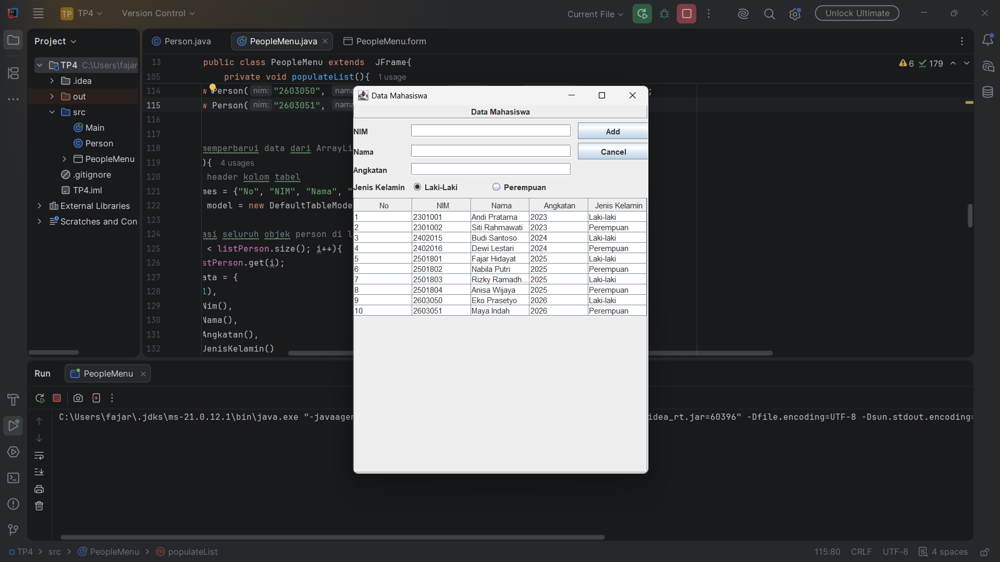
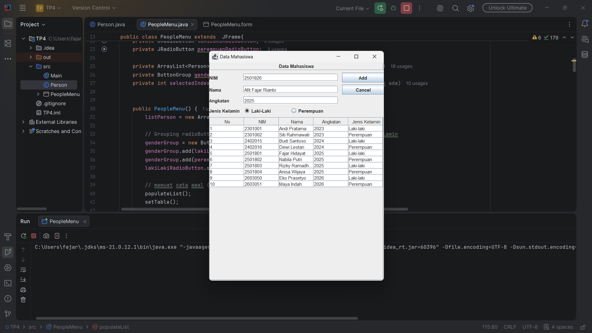
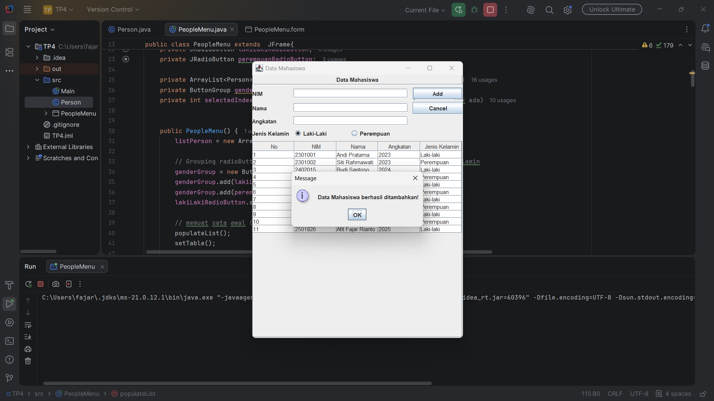
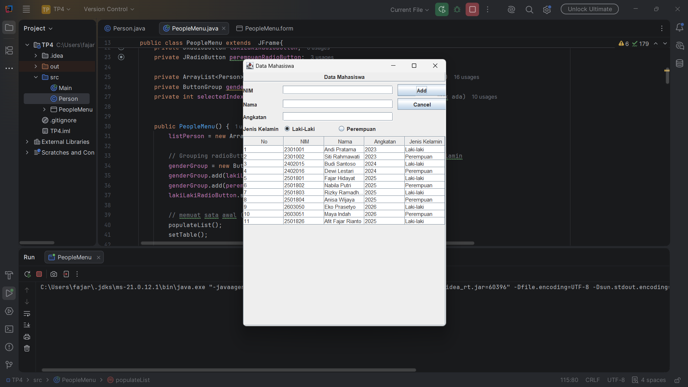
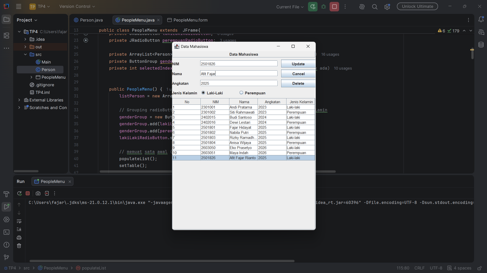
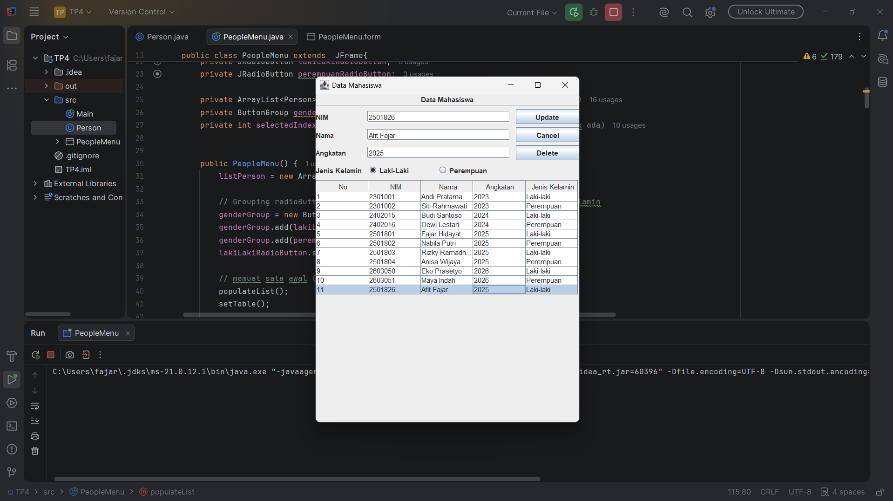
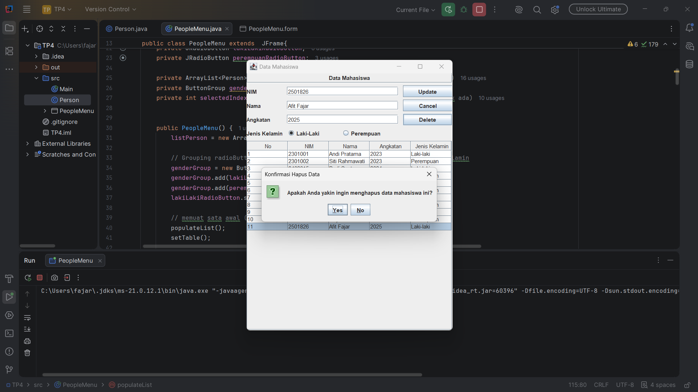
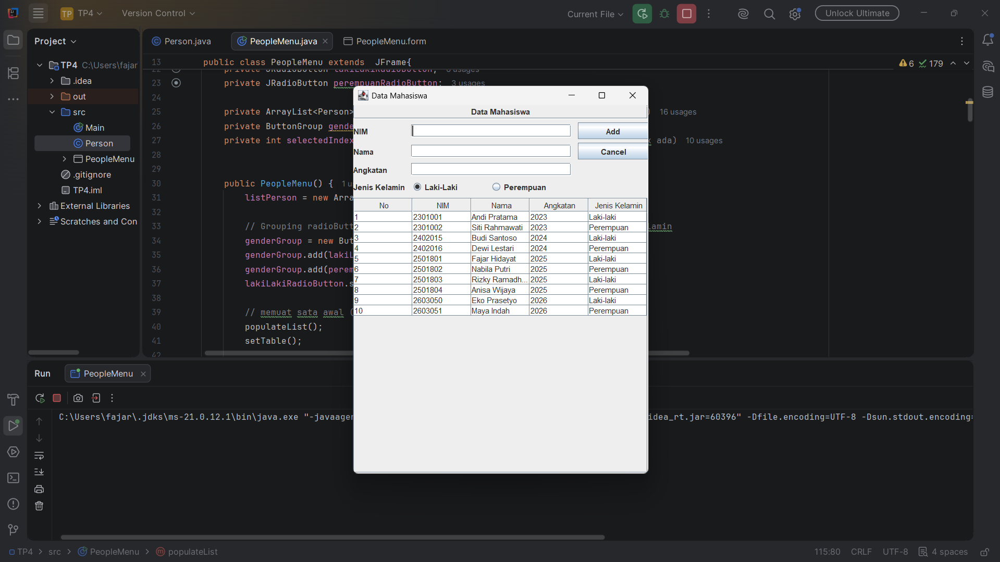

# Tugas Praktikum 3 DPBO — Java Swing GUI

## Janji

Saya Afit Fajar Rianto dengan NIM 2501826 mengerjakan Tugas Praktikum 4 pada Mata Kuliah Desain dan Pemrograman Berorientasi Objek (DPBO) untuk keberkahan-Nya maka saya tidak melakukan kecurangan seperti yang telah dispesifikasikan. Aamiin.

---
# Struktur File
```text
TP4DPBO2526C2/
├── PeopleData/
│   ├── PeopleMenu.java
│   ├── Person.java
│   └── PeopleMenu.form
│
├── Dokumentasi/
│   ├── Add.png
│   ├── AddConfirmation.png
│   ├── AddResult.png
│   ├── Delete.png
│   ├── DeleteConfirmation.png
│   ├── DeleteConfirmation2.png
│   ├── DeleteResult.png
│   ├── Preview.png
│   ├── Update.png
│   ├── UpdateConfirmation.png
│   └── UpdateResult.png
│
└── README.md
```

---
# Deskripsi Program
Program ini merupakan implementasi mengenai **Java Swing GUI**

Atribut yang digunakan:
1. NIM
2. Nama
3. Angkatan
4. Jenis Kelamin

## Alur Program
1. **Create:** Mengisi form dan menekan tombol Add untuk menambah data mahasiswa ke tabel.
2. **Read:** Data ditampilkan dalam tabel `JTable` secara dinamis.
3. **Update:** Memilih baris pada tabel, mengubah data pada form, dan menekan tombol Update.
4. **Delete:** Memilih baris pada tabel dan menekan tombol Delete, akan memunculkan konfirmasi dialog sebelum data dihapus.
---
# Dokumentasi Program

### Preview
<div align="center">
    
</div>

### ADD
<div align="center">
    
</div>

<div align="center">
    
</div>

<div align="center">
    
</div>

### Update
<div align="center">
    
</div>
<div align="center">
    
</div>
<div align="center">
    
</div>

### Delete
<div align="center">
    
</div>
<div align="center">
    
</div>
<div align="center">
    
</div>
<div align="center">
    
</div>